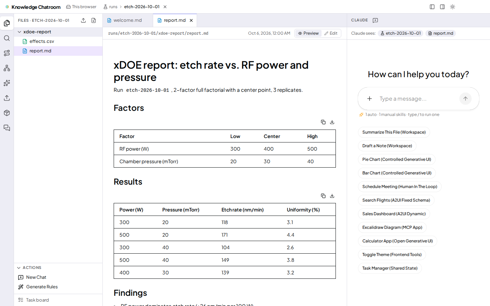
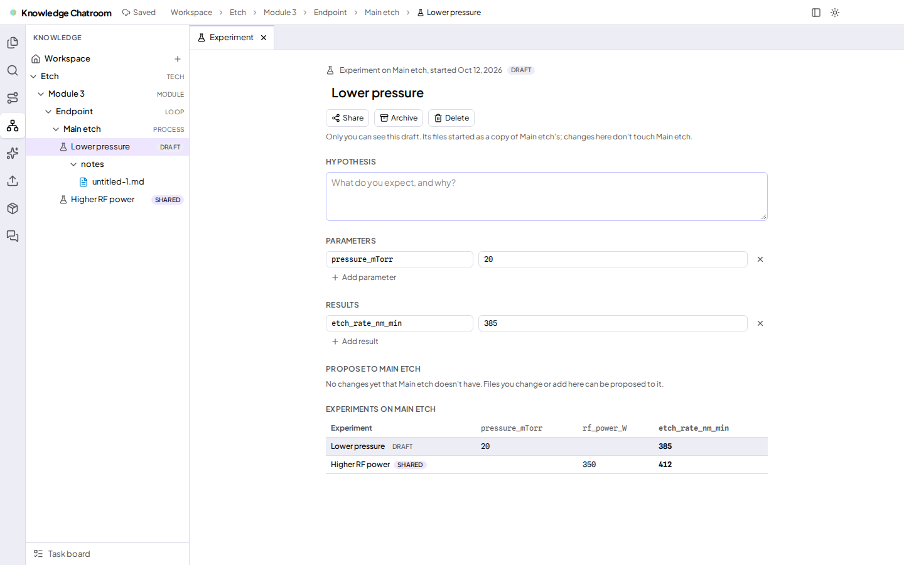
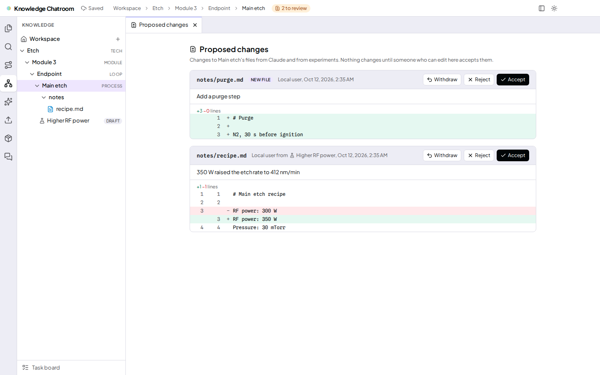

# knowledge-chatroom

An AI-assisted workspace for organizing technical knowledge and experiment reports.

Browse a run, read its report, and work with Claude using the files and selected text
as context. Keep notes in a knowledge tree, compare experiments, and review proposed
changes before bringing them into shared knowledge. The goal is to make technical
work easier to find, understand, and reuse.

## Features

- **Runs** — a run is an experiment with a report: list and compare runs in the Runs
  view, then open one with its files, report, parameters, results, and chat together.
- **Work with Claude in context** — discuss the open file or selected lines; follow
  file citations back to the editor and let Claude read, write and edit the files you
  can access. Suggestion chips under the chat offer next steps based on what is open
  and what Claude just did. Each answer's thinking and tool steps fold into one
  "Worked for 14s · 5 steps" line, which opens to show every step.
- **Search papers** — pick **Search papers** in the chat's "+" menu to search OpenAlex
  and arXiv, then save a paper to the workspace or ask about it from its card
  ([paper search server](services/papers-mcp/README.md)).
- **Bring your own tools and models** — connect the agent to outside MCP servers,
  for example the Python tools of an existing agent
  ([example](examples/python-agent/README.md)), and run any model behind an
  Anthropic-compatible gateway such as LiteLLM or OpenRouter, local models included.
- **Reuse skills** — choose Auto, Manual, or Off for each skill (for everyone, for
  yourself, or one chat), invoke it with `/name`, and see which skills a conversation used.
  Share them through the skill hub, which checks each version and shows what an update
  changes, or as `.zip` files that work in Claude Code too.
- **Personalized memory (experimental)** — with `MEMORY=on`, Claude keeps short notes
  about you across chats (who you are, how you like to work, your ongoing projects) that
  only you see. Every change shows under the reply with Undo, notes keep their versions,
  and incognito chats leave memory alone. Claude also learns from chats once they go
  quiet; with "Ask first", each change waits for your review.
  - **Shared memory**: notes for the whole workspace, a knowledge node or a group, which
    Claude reads but only proposes changes to. Teams can publish and install them as
    memory packs on the hub.
  - **Import and recall**: paste in your memory from ChatGPT or Claude. Claude can look
    back through your earlier chats and, with an embedding model, find notes by meaning.
- **Run common actions** — start a new chat about a run or generate its read-only
  rules through the same controls used by Claude.
- **Compare experiments** — fork a knowledge node, record hypotheses, parameters,
  and results, and compare experiments side by side.
- **Review proposed changes** — inspect diffs for Claude's edits to knowledge nodes
  and changes promoted from experiments, then accept or reject them.
- **Find related knowledge** — search by words, paths, or similar meaning using a
  local embedding model (or an OpenAI-compatible embeddings API such as LiteLLM or
  OpenRouter) when pgvector is available.
- **Choose storage and sharing** — start with browser-local files, or use versioned
  PostgreSQL/S3 storage with optional OIDC login and viewer/editor/owner access.
  Workspace owners manage people, roles and groups in the Admin panel.
- **Keep your chats** — each user's chat history is saved on the server, so chats can be
  reopened, renamed or archived after a reload or restart.

## Screenshots

**Focus on a run:** files on the left, the report in the middle, and Claude on the right.



**Compare experiments:** keep hypotheses, parameters, and results alongside the knowledge tree.



**Review changes:** inspect proposed edits before accepting them into a knowledge node.



These are real UI captures with sample data and a mock agent. Capture sources and
refresh instructions are in [the screenshot guide](docs/assets/README.md).

## Quick start

### Run the demo with Docker

The whole stack (UI, agent, PostgreSQL and an S3-compatible store) in one command:

```bash
cp .env.example .env           # then set ANTHROPIC_API_KEY for chat
docker compose --profile demo up --build
```

Open <http://localhost:3000>. Sample notes and runs are added on first visit and kept
in the `postgres-data`/`s3-data` volumes; `docker compose --profile demo down -v`
starts over. There is no login: one built-in user owns everything.

Two optional profiles add sample MCP servers: `--profile papers` (paper search) and
`--profile python-sample` (the Python agent's tools). Each also needs the `MCP_SERVERS`
line from the comment above its service in `docker-compose.yml`, copied into `.env`.

### Run from source

Use **Node 22** (`.nvmrc`) and pnpm (`corepack enable` picks the version in
`package.json`). Add an Anthropic API key to `.env` for real chat.

```bash
cp .env.example .env
pnpm install                   # the UI, the agent and packages/ from one lockfile
pnpm dev                       # UI :3000, agent :8000
```

Open <http://localhost:3000>. Without server storage, files stay in your browser. Runs,
the knowledge tree, sharing and memory need it: `docker compose up -d` starts
PostgreSQL and the object store, and [Development](docs/development.md) covers the
`.env` values for storage and the optional login.

### Upgrading

After pulling a new version, compare your `.env` with `.env.example`, then follow the
"Upgrading" steps for each version in the [CHANGELOG](CHANGELOG.md):

```bash
pnpm env:check              # removed, renamed and new settings; prints no values
pnpm env:upgrade            # applies it, after backing up .env
```

## Documentation

Start with the guide that matches what you want to do:

| Guide | What it covers |
| --- | --- |
| [Development](docs/development.md) | Local setup, environment variables, models, outside MCP servers, storage, and login |
| [Architecture](docs/architecture.md) | Runs, skills, actions/rules, file APIs, experiments, search, and access |
| [Testing](docs/testing.md) | Fast checks, disposable integration services, E2E modes, and CI |
| [Deployment](docs/deployment.md) | Production build, private agent routing, authentication, HTTPS, and storage |
| [Remote agent backend](docs/remote-agent.md) | Using an agent from a separate backend (`AGENT_URL`): what it receives and must do |
| [CI merge gates](docs/ci.md) | The checks required before a PR merges, and preview limits |

Two examples show how to bring outside tools in as MCP servers:
[Python agent](examples/python-agent/README.md) (an existing agent's tools and prompt) and
[paper search](services/papers-mcp/README.md) (OpenAlex and arXiv, with the chat's "+" menu).

<details>
<summary><strong>Contributor commands and project map</strong></summary>

Before opening a PR, run:

```bash
pnpm check                  # lint, UI/agent types, and service-free units
pnpm build                  # production compile with TypeScript checks
```

Use `pnpm test:e2e` for browser changes. Storage changes also need integration
and storage/login E2E coverage; [Testing](docs/testing.md) explains prerequisites.
A PR that changes the UI adds a `shot()` step to `e2e/preview.spec.ts` (or the storage
specs), so the preview comment shows it. Keep PRs small and describe the behavior
changed and how you validated it.

| Directory | Responsibility |
| --- | --- |
| `apps/web` | The Next.js UI (`@knowledge-chatroom/web`) |
| `apps/agent` | The TypeScript agent: Claude Agent SDK over AG-UI, plus the storage, skills and memory APIs |
| `apps/web/src/app` | Next.js routes, providers, authentication, and storage proxies |
| `apps/web/src/components/workspace` | File/editor UI, workbench controls, admin panel, and workspace state |
| `apps/web/src/app/declarative-generative-ui`, `apps/web/src/hooks` | Starter examples and A2UI renderers |
| `apps/agent/src` | Claude SDK adapter, AG-UI server, storage services, and tools |
| `apps/agent/src/storage/migrations` | Database schema and access policies |
| `apps/agent/skills` | Built-in skills (`analysis`, `paper-search`, `tldr`, `write-skill`) |
| `packages/contracts` | `@knowledge-chatroom/contracts`: contracts used by both the UI and the agent (files, identity tokens, text edits) |
| `scripts` | The E2E runner, CI summaries, and `env:check`/`env:upgrade` |
| `services/papers-mcp` | Paper search (OpenAlex + arXiv) as an MCP server for Claude |
| `services/lab-tools` | The Python agent sample's tools as an MCP server |
| `packages/knowledge-py` | `knowledge_chatroom`: identity, storage and memory clients shared by the Python services |
| `examples/python-agent` | Guide: bringing a Python agent in (its prompt as a skill, its tools as `services/lab-tools`) |
| `tests/unit` | Pure frontend tests without an application server or browser |
| `e2e` | UI specs, mock AG-UI agent, and test OIDC provider |
| `.github/workflows` | Quality checks, storage tests, and UI previews |

The UI uses Next.js/React and CopilotKit. The TypeScript agent uses the Claude Agent
SDK over AG-UI; optional server storage uses PostgreSQL and an S3-compatible store.

</details>

<details>
<summary><strong>How pull request previews work</strong></summary>

UI preview CI builds the app and runs deterministic browser, server-storage, and
login tests. Screenshots and a walkthrough GIF appear in a sticky PR comment;
videos, traces, and reports are attached as artifacts. Required coverage uses a
mock agent; live provider smoke tests are opt-in.

Temporary preview images on the `ui-previews` branch are removed when a PR closes.
The README screenshots in `docs/assets/` remain part of the repository.

</details>

## Origin and license

MIT — see [LICENSE](LICENSE). Based on CopilotKit's
[claude-sdk-typescript starter](https://github.com/CopilotKit/CopilotKit/tree/main/examples/integrations/claude-sdk-typescript).

<details>
<summary><strong>Upstream documentation</strong></summary>

- [Claude Agent SDK](https://docs.claude.com/en/api/agent-sdk/overview)
- [CopilotKit](https://docs.copilotkit.ai)
- [AG-UI](https://docs.ag-ui.com)
- [Next.js](https://nextjs.org/docs)

</details>
