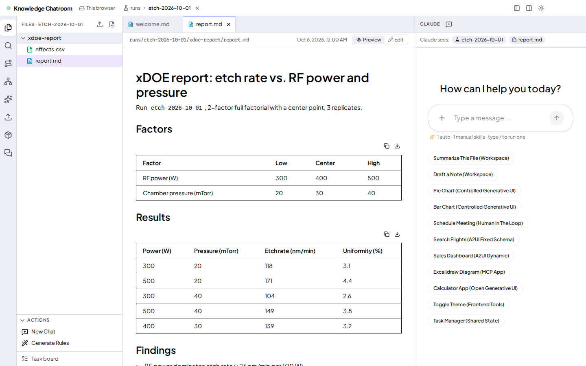
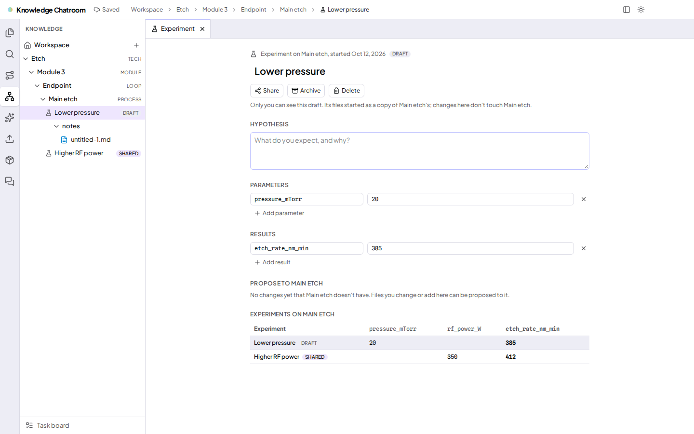
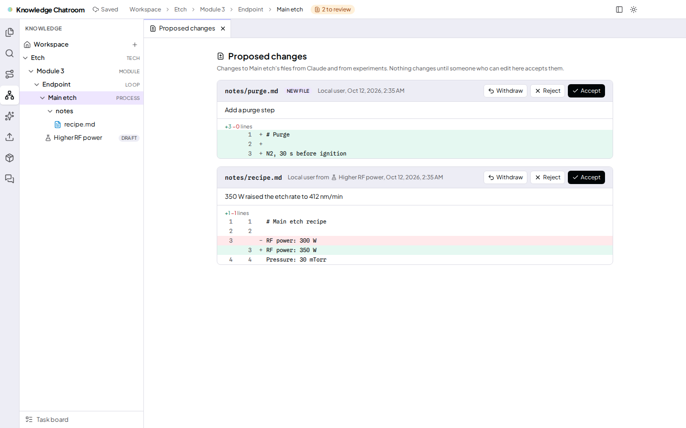

# knowledge-chatroom

An AI-assisted workspace for organizing technical knowledge and experiment reports.

Browse a run, read its report, and work with Claude using the files and selected text
as context. Keep notes in a knowledge tree, compare experiments, and review proposed
changes before bringing them into shared knowledge. The goal is to make technical
work easier to find, understand, and reuse.

## Features

- **Browse and focus on runs** — explore runs in Traverse mode, then open one in
  Focus mode with its files, report, and chat together.
- **Work with Claude in context** — discuss the open file or selected lines; follow
  file citations back to the editor and let Claude work with accessible files.
  Suggestion chips under the chat offer next steps based on what is open and what
  Claude just did.
- **Bring your own tools and models** — connect the agent to outside MCP servers,
  for example the Python tools of an existing agent
  ([example](examples/python-agent/README.md)), and run any model behind an
  Anthropic-compatible gateway such as LiteLLM or OpenRouter.
- **Reuse skills** — choose Auto, Manual, or Off for each skill (for everyone, for
  yourself, or one chat), invoke it with `/name`, and see which skills a conversation used.
  Share them through the skill hub, which checks each version and shows what an update
  changes, or as `.zip` files that work in Claude Code too.
- **Run common actions** — start a new chat about a run or generate its read-only
  rules through the same controls used by Claude.
- **Compare experiments** — fork a knowledge node, record hypotheses, parameters,
  and results, and compare experiments side by side.
- **Review proposed changes** — inspect diffs for Claude's edits to knowledge nodes
  and changes promoted from experiments, then accept or reject them.
- **Find related knowledge** — search by words, paths, or similar meaning using a
  local embedding model (or an OpenAI-compatible embeddings API such as LiteLLM or
  OpenRouter) when pgvector is available.
- **Choose storage and sharing** — start with browser-local files, or use versioned
  PostgreSQL/S3 storage with optional OIDC login and viewer/editor/owner access.
  Workspace owners manage people, roles and groups in the Admin panel.

## Screenshots

**Focus on a run:** files on the left, the report in the middle, and Claude on the right.



**Compare experiments:** keep hypotheses, parameters, and results alongside the knowledge tree.



**Review changes:** inspect proposed edits before accepting them into a knowledge node.



These are real UI captures with sample data and a mock agent. Capture sources and
refresh instructions are in [the screenshot guide](docs/assets/README.md).

## Quick start

### Run the demo with Docker

The whole stack (UI, agent, PostgreSQL and an S3-compatible store) in one command:

```bash
cp .env.example .env           # then set ANTHROPIC_API_KEY for chat
docker compose --profile demo up --build
```

Open <http://localhost:3000>. Sample notes and runs are added on first visit and kept
in the `postgres-data`/`s3-data` volumes; `docker compose --profile demo down -v`
starts over. There is no login: one built-in user owns everything.

### Run from source

Use **Node 22** (`.nvmrc`) and npm. Add an Anthropic API key to `.env` for real chat.

```bash
cp .env.example .env
npm ci                         # installs the UI and agent from their lockfiles
npm run dev                    # UI :3000, agent :8000
```

Open <http://localhost:3000> and choose a sample run in Traverse to enter Focus.
Server storage and login are optional; see [Development](docs/development.md).

## Documentation

Start with the guide that matches what you want to do:

| Guide | What it covers |
| --- | --- |
| [Development](docs/development.md) | Local setup, environment variables, storage, and login |
| [Architecture](docs/architecture.md) | Runs, skills, actions/rules, file APIs, experiments, search, and access |
| [Testing](docs/testing.md) | Fast checks, disposable integration services, E2E modes, and CI |
| [Deployment](docs/deployment.md) | Production build, private agent routing, authentication, HTTPS, and storage |

<details>
<summary><strong>Contributor commands and project map</strong></summary>

Before opening a PR, run:

```bash
npm run check                  # lint, UI/agent types, and service-free units
npm run build                  # production compile with TypeScript checks
```

Use `npm run test:e2e` for browser changes. Storage changes also need integration
and storage/login E2E coverage; [Testing](docs/testing.md) explains prerequisites.
Keep PRs small and describe the behavior changed and how you validated it.

| Directory | Responsibility |
| --- | --- |
| `src/app` | Next.js routes, providers, authentication, and storage proxies |
| `src/components/workspace` | File/editor UI, workbench controls, admin panel, and workspace state |
| `src/app/declarative-generative-ui`, `src/hooks` | Starter examples and A2UI renderers |
| `agent/src` | Claude SDK adapter, AG-UI server, storage services, and tools |
| `agent/src/storage/migrations` | Database schema and access policies |
| `examples/python-agent` | Sample: a Python agent's tools as an MCP server and its prompt as a skill |
| `tests/unit` | Pure frontend tests without an application server or browser |
| `e2e` | UI specs, mock AG-UI agent, and test OIDC provider |
| `.github/workflows` | Quality checks, storage tests, and UI previews |

The UI uses Next.js/React and CopilotKit. The TypeScript agent uses the Claude Agent
SDK over AG-UI; optional server storage uses PostgreSQL and an S3-compatible store.

</details>

<details>
<summary><strong>How pull request previews work</strong></summary>

UI preview CI builds the app and runs deterministic browser, server-storage, and
login tests. Screenshots and a walkthrough GIF appear in a sticky PR comment;
videos, traces, and reports are attached as artifacts. Required coverage uses a
mock agent; live provider smoke tests are opt-in.

Temporary preview images on the `ui-previews` branch are removed when a PR closes.
The README screenshots in `docs/assets/` remain part of the repository.

</details>

## Origin and license

MIT — see [LICENSE](LICENSE). Based on CopilotKit's
[claude-sdk-typescript starter](https://github.com/CopilotKit/CopilotKit/tree/main/examples/integrations/claude-sdk-typescript).

<details>
<summary><strong>Upstream documentation</strong></summary>

- [Claude Agent SDK](https://docs.claude.com/en/api/agent-sdk/overview)
- [CopilotKit](https://docs.copilotkit.ai)
- [AG-UI](https://docs.ag-ui.com)
- [Next.js](https://nextjs.org/docs)

</details>
