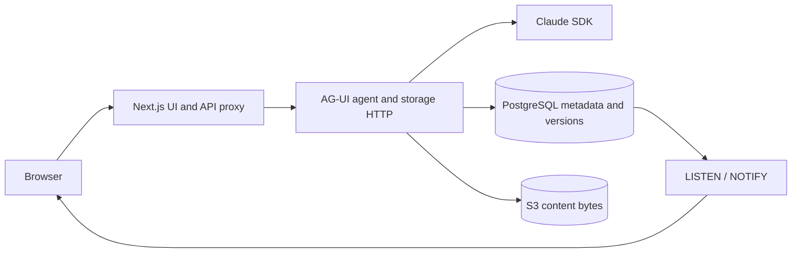

# Architecture

The browser renders a Next.js workspace. CopilotKit's runtime route connects to
an AG-UI agent on port 8000; `agent/src/server.ts` streams the Claude SDK adapter.
With `AGENT_URL` set, the chat goes to a remote backend's `/agent/report` instead
([Remote agent backend](remote-agent.md)), and each run carries the user and their
place in `forwardedProps.knowledge_chatroom`.
The agent also hosts storage HTTP routes and per-user file/node/experiment tools.
`src/lib/agent-proxy.ts` forwards storage requests and attaches a signed identity
when login is enabled. Browser state and authenticated storage access meet in
`src/components/workspace/store.tsx`; pane commands live in `workbench.tsx`.



The frontend and agent have separate manifests and lockfiles. `npm ci` at the
root installs both. The starter's charts, meeting picker and A2UI examples remain
under `src/app/declarative-generative-ui` and `src/hooks`; they are separate from
the knowledge workspace's persistence responsibilities.

### Skills

Skills are `SKILL.md` folders in the [Claude Code / Agent Skills](https://docs.claude.com/en/docs/agents-and-tools/agent-skills/overview)
layout. Claude gets the built-in ones (`agent/skills/`), skills installed from the
[skill hub](#skill-hub), and the workspace's own `skills/<name>/` at the root (with
[file storage](#file-storage)); a workspace skill hides a hub or built-in one of the same name.
In the **Skills** view each one is set to:

- **Auto:** Claude uses it when it fits, and `/name` runs it.
- **Manual:** only when you type `/name` in the chat.
- **Off:** not available.

A mode can be chosen at three levels, and the most specific one applies: **for everyone**
(set in the Skills view by editors and owners of the workspace root), **yours** (the Skills
view's Auto / Manual / Off, with "Use default" to go back), and **this chat** (the "This chat"
button under the input). Anyone who can read a skill can use it; adding or changing one
takes edit access to the workspace's `skills/` folder. When Claude writes a skill, it becomes a
proposed change that someone with edit access accepts, and Claude never turns skills on or off.

Typing `/` in the chat lists the skills you can run; the line under the
input says which skills are on and which ones the current turn used. By default skills are
instructions only: no shell, and `!` commands in a SKILL.md are not run. The agent server copies
each user's skills into its own working folder for runs (`SKILLS_RUN_DIR`, default a temp
folder), and only `/name` for one of those skills reaches the SDK as a command.

#### Skill scripts

A deployment can let skills run the scripts they ship (`scripts/`, `*.py`, `*.sh`, ...) with
`SKILL_SCRIPTS=on` (`agent/src/skills/run.ts`). A run whose skills include one with scripts then
gets the SDK's Bash tool, always inside the SDK's sandbox (bubblewrap on Linux, which the agent
host must have; the run fails rather than run a command unsandboxed):

- **No network**: commands can't reach the internet, other hosts or the agent's own ports.
- **Files**: writes only in the user's run folder, and not to its skills, its workspace copy
  (below) or the files the SDK reads as instructions there (`CLAUDE.md`, `CLAUDE.local.md`,
  `.mcp.json`). The agent's own
  folder (code, `.env`), its home (including the SDK's chat history), other users' run folders
  and the usual secret mounts (`/run/secrets`, `/var/run/secrets`, `/etc/secrets`) can't be
  read; `SKILL_SCRIPTS_DENY_READ` (comma-separated absolute paths) adds more. Other processes,
  the agent's included, aren't visible.
- **No secrets**: the run's environment keeps only basics such as `PATH`, `HOME`, the locale and
  the model, so no `DATABASE_URL`, `AUTH_SECRET`, S3 or proxy settings. The SDK itself needs an
  API key, and its commands would inherit it, so the run gets a stand-in key that only a proxy
  inside the agent accepts (`agent/src/skills/keyproxy.ts`, on 127.0.0.1); the proxy sends
  requests on to Anthropic with the real key.

Commands run without a permission prompt because they're sandboxed; `!` commands in a SKILL.md
stay off. The Skills view marks a skill with scripts with a terminal icon when they run, and a
warning when they don't. Python or other interpreters the scripts need must be installed on the
agent host.

#### Working folder

With file storage, each user's run folder also holds `workspace/`, a read-only copy of every
file that user can read (`agent/src/storage/workdir.ts`), so the SDK's built-in tools work on
the workspace like on a local project:

- **Layout**: `workspace/root/` is the workspace root, `workspace/nodes/<tech>/<module>/...`
  the knowledge nodes by name (child nodes as subfolders), `workspace/experiments/<title> (<id>)/`
  each experiment the user can see. `workspace/.places.json` maps each folder to its node or
  experiment id and the user's role, and lists files left out.
- **Sync**: at the start of each run, through the user's own session (the same permission checks
  and row security as the file tools). Only files whose content changed are downloaded; deleted
  ones are removed. It is a snapshot: changes made during a run show up in the next one.
  A run Claude starts in the turn gets its linked inputs copied to `run-inputs/<run id>/`
  (the exact versions the run read, which the snapshot may predate); the next sync drops
  them, since the run's own folder then holds them.
  `AGENT_WORKDIR_MAX_MB` (default 500) caps the copy, smallest files first, and
  `AGENT_WORKDIR_MAX_FILE_MB` (default 25) leaves out larger files.
- **Tools**: Claude gets Read, Glob and Grep, which a hook confines to the run folder (links out
  of it included), since they don't run in the sandbox. Bash still comes only with skill scripts,
  sandboxed as above; scripts can read `workspace/` but not change it.
- **Writing back**: changes still go through `write_file`, so read-only files stay unchanged,
  writes in a node or to skills become proposals and every write is a version. `save_file` stores
  a file a script made in the run folder (a plot, a CSV) the same way.

`AGENT_WORKDIR=off` turns the copy and those tools off.

### Skill hub

With file storage, a deployment has one skill hub (`011_skill_hub.sql`), opened with
**Browse hub** in the Skills view:

- **Publish** (owners of the workspace root) snapshots a workspace skill as the next numbered
  version. A version never changes: its files are stored as blobs by content hash, and
  publishing unchanged files adds no version. Whoever publishes a name first owns it on the hub.
- **Install** (editors) pins a version for the whole workspace. Hub skills start as **Manual**,
  so someone else's instructions reach Claude only when a user runs `/name`, until someone
  makes them Auto. A newer version shows as **Update to vN** on the skill's row.
- **Fork** (editors) copies the installed version into `skills/<name>/` to change it there,
  and removes the install it replaces.
- **Export** downloads any skill as a `.zip` in the Agent Skills layout (`<name>/SKILL.md`, ...),
  which Claude Code reads too; **Import .zip** (editors) adds one as `skills/<name>/`, asking
  before it replaces a folder that exists. A skill may have up to 200 files and 5 MB.

Trust (`012_hub_trust.sql`) helps people decide what to install:

- **Publish check**: each version is scanned as it's published (`agent/src/skills/scan.ts`) for
  scripts, links and network commands, large or binary files, hidden text (invisible characters,
  HTML comments, long encoded runs) and instructions such as "ignore previous instructions" or
  "don't tell the user". Flags show on the hub and before an update; they warn, they don't block,
  and a clean check doesn't mean a skill is safe.
- **Verified**: hub admins mark a version as checked. Admins are the users listed in
  `HUB_ADMINS` (emails or login subjects), plus the built-in user when there is no login. A new
  version starts unverified.
- **Reports**: anyone can report a skill; its publisher and the hub admins see open reports, and
  admins dismiss them. Each person has one open report per skill.
- **Yank**: a skill's publisher or an admin can yank a version. It can't be newly installed,
  and "latest" skips it; workspaces that have it keep it working, with a warning to update or
  remove it.
- **Update diffs**: **Update to vN** first shows the file-by-file diff and the new version's
  flags, and updates only when confirmed.

Claude has no tools for the hub: installing, publishing and forking are the user's own
actions. `GET /api/hub?q=` lists and searches, `GET /api/hub/<name>?version=` shows a version's
SKILL.md, `POST /api/hub {skill}` publishes, `PUT|DELETE /api/hub/<name>/install` installs
(`{version?}`) or removes, `POST /api/hub/<name>/fork` forks, and `GET /api/skills/<name>/export`
and `POST /api/skills/import?replace=1` move `.zip` files. For trust:
`GET /api/hub/<name>/diff?from=&to=`, `POST /api/hub/<name>/verify {version, verified}`,
`POST /api/hub/<name>/yank {version, yanked, reason?}`, `POST /api/hub/<name>/reports
{reason, version?}` and `DELETE /api/hub/<name>/reports?id=`.

### Runs are experiments

A **run** is an experiment (see Experiments below) with a report: its `report.md`, or
`xdoe-report/report.md` for one made from an xDOE run folder. There is no separate run
folder or mode (issue #82):

- The **Runs** view on the icon rail lists the runs where you are and below it. At the
  workspace root that is every run you can see, so the app name in the title bar goes there.
  **+** starts a run where you are (a fork of the node's files, or an empty run at the root),
  and **Compare** opens the **Runs** tab: one row per run with its state, place, author and
  every parameter and result as a column.
- Opening a run moves the workspace into it and opens its report, unless one of its files is
  already open. Claude gets it as `currentExperiment`, with its state and report.
- A run's **state** says how far it got (ready, running, done, failed), apart from its
  **status**, which says who sees it (draft, shared, archived).
- The run you're in is in the URL (`/?experiment=<id>`), so links open a run directly and
  back/forward move between runs. A link to one that isn't there, or isn't shared with you,
  drops out of the URL with a notice. Old `?run=` links are dropped the same way.
- **Run folders** from before (a folder holding `xdoe-report/`) are listed at the bottom of
  the Runs view for anyone who can edit there. **Make run** moves the folder's files, with
  their history, into a new draft run named after the folder (`POST
  /experiments/from-folder`).

- **Runs Claude starts** (`create_experiment`, `agent/src/storage/session.ts` `startRun`)
  begin in state running. The files the run works from are its **inputs**: each is linked
  in read only under `inputs/`, at the version it had then and sharing its stored bytes, so
  later changes to the original don't change what the run read, and promoting the run never
  proposes them back. Starting one needs view access where it goes and read access to each
  input; it is a draft of the signed-in user's, and Claude writes only into runs that user
  authored. `set_experiment_results` records the results and ends it (done or failed).
- **Provenance**: the run records who started it and when, the chat it came from, the
  model, the skill it followed (name, source, hub version, and a hash of its files), the
  agent and Claude Agent SDK versions, and each input's original place, version and
  SHA-256 (`experiments.provenance`, migration `016_run_provenance.sql`; set by the agent
  only, never by the API). The run's `report.md` carries the same record in its front
  matter, refreshed when the results are set (`agent/src/storage/run-report.ts`), and the
  run panel shows it under **Provenance**, with the inputs to open.
- **Reruns** (`create_experiment` with `rerunOf`, `Session.rerun`): a new run in the same
  place with the old run's parameters, hypothesis and the very input versions it read (from
  its `inputs/`), unless changed (including `node`, to rerun elsewhere). The old run stays as it ended; a finished run can't be
  finished again with other results. The new run's provenance and front matter name the old
  one (`rerun_of`) by id only, since the old run may be a draft its viewers can't see; the
  panel links back to it for those who can see it.
- **Analysis** is the built-in `analysis` skill (`agent/skills/analysis/`, Auto by default):
  Claude starts a run with the user's files as inputs, reads them from the run, writes the
  report from `reference/report-template.md` and records the results. With
  `SKILL_SCRIPTS=on` it can also profile the run's copy of CSV inputs with its
  `scripts/profile.mjs` (plain Node: per-column counts, missing values, numeric statistics,
  top values) and save what
  scripts make into the run. Long analyses still run within one chat turn; background jobs
  with progress are a later step.

Runs need server storage; a browser-only workspace has none.

### Actions

Inside a run the Files view ends with a foldable **Actions** block (like VS Code's Outline
and Timeline sections), whose buttons act on the current run:

| Action | Role | Does |
| --- | --- | --- |
| **New Chat** | viewer | starts an empty conversation, still about the same run |
| **Generate Rules** → **Open Rules** | editor to generate, viewer to open | without the run's `models/general_rules.md`: asks the rules API once, writes the file read-only and opens it; once it exists: opens it |

Actions are entries in one registry (`src/components/workspace/actions.tsx`), each with an
id, the role it needs, whether Claude may run it, a `view(ctx)` that gives its label, icon
and state for the current run, and a `run(ctx)` that acts only through the workbench
contract and the file API. One runner serves the block and Claude: it refuses disabled,
unauthorized or already-running actions, so a double click never runs one twice.

The role is the user's role in the run: editor for its author while it isn't archived, viewer
for everyone else who can see it. A viewer sees Generate Rules disabled, with a tooltip saying
why, and Claude acting for them gets the same refusal. The server checks again: any write, a
read-only file included, needs editor.

#### Rules API

Generate Rules gets JSON from `GET /api/rules?run=<title>&experiment=<id>` (the run's title
and experiment id). The Next.js server forwards that to `RULES_API_URL` (`GET
<url>?run=<title>&experiment=<id>`), so the API's address stays off the browser. Without
`RULES_API_URL` it answers with a built-in mock (`src/lib/rules-mock.ts`), which is also served
at `/api/mock/rules`. The answer looks like this:

```json
{ "run": "etch-2026-10-01", "generatedAt": "2026-10-08T00:00:00.000Z",
  "rules": [{ "id": "R1", "title": "…", "condition": "…", "action": "…", "confidence": 0.93 }] }
```

A fixed transform (`src/components/workspace/rules.ts`, unit tested) turns it into a markdown
table. The file is written once and is read-only for everyone, Claude included: the editor
only previews it, and the file API refuses to change or delete it.

The API is called at most once per run. The button is disabled while it works, and a lock
shared by the browser's tabs, plus a check with the server just before the call, stops a
second tab from asking again. The write only creates (`If-None-Match: *`), so even two
browsers can't overwrite the file.

### Workbench contract

Everything that moves panes goes through one typed API, `useWorkbench()`
(`src/components/workspace/workbench.tsx`): title bar buttons, the icon rail, the phone pane
switcher, file references in answers, and Claude's open-file tools.

| Part | Does |
| --- | --- |
| `panes.isOpen / show / hide / toggle(pane)` | `"explorer"`, `"editor"` or `"chat"`; on phones `show` switches to that pane |
| `panes.resize / resetSize(pane, width)` | splitter drags, clamped to each pane's range |
| `sidebar.select / show(view)` | the icon rail (`select` on the active view collapses the panel) |
| `editor.open(path, lines?)` | opens a file or the task board, optionally at cited lines |
| `chat.newThread() / focus()` | starts an empty conversation / puts the cursor in the chat |
| `notify(message, level)` | a short notice in the corner |

Claude drives the same contract through frontend tools: `showPane` / `hidePane`,
`listRuns` / `openRun`, `openWorkspaceFile`, and `listActions` / `runAction`. `runAction`
goes through the Actions block's runner with the user's role, and only runs actions marked
`agentInvocable` (Generate Rules is; New Chat isn't, since it would end Claude's own
conversation). `openRun` moves the workspace into another run, and the conversation carries
on. Moving between runs and places goes through the workspace (`enterExperiment`,
`enterNode`); the workbench keeps the URL in step.

The layout itself is plain data changed by a reducer (`layout.ts`), so its rules are unit
tested (`tests/unit/workbench.spec.ts`), and a test fails if anything outside the workbench starts
keeping its own pane state.

### Chat suggestions

The chips under the chat come in two rounds. Before the first message they follow what is
open (`src/components/workspace/chat-suggestions.ts`): summarize the open file, draft a note,
analyze the open run's report, and, with server storage, search for similar experiments.
After each reply CopilotKit asks a separate `suggester` agent for follow-ups. The chat agent
can't serve that request, because CopilotKit forces a single tool call and the Claude Agent SDK
would run a whole turn with file tools, so the agent's `POST /suggest` (`agent/src/suggest.ts`)
makes one Messages API call on a small model with the conversation and the workspace context,
and streams back only that tool call. Nothing is stored and no tools run. The browser freezes
the first-round chips once the chat starts, since any change would reload the follow-ups.
`CHAT_SUGGESTIONS=static` on the UI leaves the suggester out.

### Chat history

Each user's chats are kept on the server, so they come back after a reload or a restart
(issue #91). The chat pane's history button lists them, newest first, named after the first
question; each can be opened again, renamed, archived or deleted.

- `src/lib/chat-runner.ts` is the CopilotKit runtime's runner. A live run streams from memory
  (so reconnecting mid-run works); when it finishes, its compacted AG-UI events and the
  messages after it are saved. Opening a chat replays its saved runs.
- `src/lib/chat-store.ts` saves them through the agent server's `/chats` API
  (`agent/src/storage/chats.ts`, tables `chats` and `chat_runs` from `017_chats.sql`) when
  it has storage, else in this process's memory (lost on restart, still one history per
  user).
- `src/lib/chat-routes.ts` answers the runtime's thread routes (`/api/copilotkit/threads…`)
  for the signed-in user; `src/components/workspace/chat-history.tsx` is the list.
- A chat belongs to the user who started it. Nobody else lists, opens, continues or stops it,
  workspace owners included; with row-level security Postgres enforces this too. Storage
  tokens (MCP servers, remote backends) can't reach chats. The follow-up chips' `suggester`
  runs are not kept.
- With `CPK_INTELLIGENCE_API_KEY` set, CopilotKit Intelligence keeps threads instead.

### Personalized memory

With `MEMORY=on` and server storage, Claude keeps short notes about each user across chats
(issue #93, experimental). A note is markdown with a name, a one-line description and a
type (`profile`, `preference`, `project`, `feedback`, `reference`), the same shape as Claude
Code's memory files and `SKILL.md`.

- `agent/src/storage/memory.ts` keeps them (tables from `018_memory.sql`). Each note belongs
  to one user; nobody else reads it, workspace owners included, and with row-level security
  Postgres enforces this too. Every change is a version. Claude's changes and reads are also
  `memory_events`, which is what Undo works from. When Claude deletes a note, it is only
  archived; when the user deletes one, it is gone for good, with its versions.
- `agent/src/memory/run.ts` gives a chat run the user's memory, unless memory is off for them
  or the chat is incognito. The system prompt gets an index of the notes (one line each,
  the most recently used first, within 6,000 characters). Claude gets `memory_view`,
  `memory_search`, `memory_save`, `memory_edit` and `memory_delete`. Each read or change
  goes to the browser as an AG-UI custom event `memory`.
- `agent/src/memory/http.ts` serves `/memory`, the user's own notes, settings, undo and
  `.zip` export. The app forwards `/api/memory` to it. Without `MEMORY=on` or storage it
  answers 404, and the app hides memory.
- `src/components/workspace/memory.tsx` has the Memory view (list, on/off, export), the note
  editor in the middle pane (versions, restore, archive, delete) and the line under the
  chat input. That line shows what Claude used and changed this turn, with Undo, and the
  incognito toggle.
- Learning (`019_memory_learning.sql`). Memory mode is `on`, `ask` or `off`. In `ask`
  mode, and in any run that has used a tool other than the memory tools (a `PreToolUse`
  hook marks the run, since files, web pages and MCP results may carry injected text),
  Claude's saves, edits and deletes become proposals in `memory_inbox` instead. The user
  accepts or rejects them in the Memory view; accepting applies the change against the
  version it was made on, or reports a conflict.
- `agent/src/memory/learn.ts` is the background learner. Every minute it picks chats idle
  for `MEMORY_IDLE_MINUTES` (default 10) and at most 3 days old, not incognito, whose
  owner has memory on or ask, and asks a small model (`MEMORY_MODEL`, else the follow-up
  chips' model) for at most 5 changes to the notes, covering new facts, duplicates,
  contradictions and stale notes. Changes apply directly in `on` mode (with Undo, listed
  under "Recent changes by Claude") or go to the inbox in `ask` mode.
  `memory_learned_chats` records how far each chat was learned. `MEMORY_LEARN=off` turns
  it off.
- Shared memory (`020_shared_memory.sql`, `agent/src/storage/shared-memory.ts`): notes for
  the workspace, a knowledge node (and everything below it) or a group (and its
  sub-groups). `shared_memory_rank` decides who reads and edits each place from the
  grants: anyone with a grant in the workspace reads its notes and editors of the
  workspace root edit them; a node's readers and editors likewise; a group's members
  (and workspace owners) read and edit its notes. A run gets the workspace's notes, its
  user's groups' and those of the node the user is in and the nodes above it (the
  browser's place in `forwardedProps`). Each note is Auto (in the prompt's index),
  Manual (only `memory_search` finds it) or Off, for everyone (set by its editors) and
  per person. Claude addresses a shared note as `shared:<id>`; reading one counts as
  outside content for the inbox guard, and `memory_save`, `memory_edit` and
  `memory_delete` on one, or `memory_save` with `scope: workspace | node`, only propose:
  someone who edits the place accepts or rejects it in the Memory view, and accepting
  credits the author. A person shares one of their own notes by copying it (a
  snapshot, checked before it goes): directly where they edit, else as a proposal.
- Memory packs (`021_memory_packs.sql`, `agent/src/storage/memory-packs.ts`): a place's
  own shared notes published to the hub (one per deployment, like skills) as immutable,
  numbered versions. Whoever publishes a name first owns it; unchanged notes add no
  version, and each version is scanned like a skill (`skills/scan.ts`). A place's editors
  install a pack pinned to a version: its notes become the place's shared notes with
  `pack_install_id` set, Manual for everyone, and read-only (the API and Claude's
  proposals refuse to change them). Moving the install to another version updates the
  notes in place and keeps their modes; uninstalling deletes them; forking clears
  `pack_install_id` so they become the place's own. Hub admins (`HUB_ADMINS`) verify
  versions; the publisher or an admin yanks one, which keeps existing installs but blocks
  new ones. The Memory view lists installs, and the hub opens in the middle pane.
- Import (`agent/src/memory/import.ts`, `POST /memory/import`): notes with front matter
  (this app's `.zip` export, Claude Code memory files) are read as they are; other text,
  such as ChatGPT's or Claude's memory pasted in, goes to `MEMORY_MODEL`, which sorts it
  into notes and merges it with the user's own (at most 30). Every note goes to the
  inbox (`source = 'import'`), never straight into memory. Without a model the text
  becomes one note.
- Outside MCP servers (`memoryAccess`, `/memory/agent` in `agent/src/memory/http.ts`):
  a run with memory sends such servers an `X-Knowledge-Memory` token naming the user,
  the chat and its node. With it, a server gets the chat's memory prompt and runs the
  same `memory_*` tools as Claude, with the run marked as having read outside
  content, so every change waits in the inbox. Events reach the browser through the
  live run of that chat (`trackLiveRun`).
- Not yet: suggesting notes become skills or knowledge nodes, semantic search over
  memory, and search over past chats. These are the rest of #93's step 5.

### File references in answers

Claude's answers can point at a file, or at lines in it, and a click opens them in the middle
pane. A reference is a plain Markdown link to the workspace path, with a GitHub-style line
fragment (the format Claude Code uses in IDEs):

| Claude writes | A click opens |
| --- | --- |
| `[welcome.md](notes/welcome.md)` | the file |
| `[welcome.md:12](notes/welcome.md#L12)` | the file at line 12 |
| `[welcome.md:12-18](notes/welcome.md#L12-L18)` | the file at lines 12–18 |

Paths are relative to the workspace root; lines are 1-based and inclusive. The preview
highlights the paragraphs, list items, table rows or code blocks the lines belong to, and the
editor selects the lines themselves. Links to files that aren't in the workspace show greyed
out, and web links work as before.

Claude learns the format from the system prompt (`agent/src/agent.ts`), and file content
reaches it with numbered lines (the open file in context, and `readWorkspaceFile`), so it can
cite them. The contract lives in `src/components/workspace/file-refs.ts`, whose parser also
accepts `#L12-18` and `notes/welcome.md:12`.


## File storage

Workspace files can live in Postgres + an S3-compatible object store instead of
the browser (see issue #4). It is optional; without
`DATABASE_URL` the app runs as before.

For local setup, see [Development](development.md).

- **Postgres** (15 or newer) holds the file tree, every version of every file, and who
  wrote it (`agent/src/storage/migrations`). Migrations run when the agent starts.
- **Object store** holds the bytes, keyed by their sha256, so identical content is
  stored once and old versions stay readable. Any S3-compatible store works:
  SeaweedFS or Garage self-hosted, or AWS S3, Cloudflare R2, Backblaze B2.
- **API**: the agent server serves `/files` and Next.js forwards `/api/files/*` to it.
  `GET /api/files` lists files, `GET|PUT|DELETE /api/files/<path>` reads, writes
  (request body = bytes) and deletes one, `PATCH /api/files/<path>` with `{"path": ...}`
  renames it within the same place (history kept; 412 when the name is taken),
  `?versions` returns its history, and
  `GET /api/files?watch` streams every change as server-sent events (Postgres
  LISTEN/NOTIFY, so it works across processes). A `PUT` with `If-None-Match: *` only creates
  (412 if the file exists), and `X-Read-Only: true` makes a new file read-only: after that,
  `PUT` and `DELETE` answer 403, for every role. Login is optional (see below); keep the agent port private in either mode.
- **Knowledge tree**: files live at the workspace root or in a node of a tree whose levels
  are data (`node_types`, seeded as tech › module › loop › process). Nodes are stored with
  Postgres `ltree`, and the database checks that each node sits exactly one level below its
  parent. Each node has its own files. `GET|POST /api/nodes` lists and adds nodes,
  `GET|PATCH|DELETE /api/nodes/<id>` reads (with its ancestors), renames and deletes one
  (with everything below it), and every `/api/files` route takes `?node=<id>`.
- **Experiments**: anyone who can view a node (usually a process) can fork it into an
  experiment. The experiment gets its own copy of the node's file list, pointing at the same
  stored bytes, and from then on every change, by the user or by Claude, stays in the
  experiment. Anyone with a role at the workspace root can also start one there, which
  starts empty (`015_runs.sql`). An experiment with a report is a run (above). It records a hypothesis, parameters and results as JSON, so the experiments on
  one node compare side by side. A draft is seen only by its author; shared and archived ones
  by everyone who can view the node; only the author changes it, and an archived one is read
  only until restored. Its `state` (ready, running, done, failed) says how far the run got.
  `GET|POST /api/experiments` lists (optionally `?node=<id>`, or `?node=root`) and forks
  (`nodeId: null` for the root), `POST /api/experiments/from-folder {nodeId, folder}` moves a
  folder into a new one, `GET|PATCH|DELETE /api/experiments/<id>` reads, changes and deletes
  one, and every `/api/files` route takes `?experiment=<id>`. In the Knowledge view,
  experiments sit under their node (root ones under Workspace) with their status and state,
  and the Experiment tab holds the details and a comparison table. Its author brings its results to the node by proposing them (below).
- **Proposed changes**: a change to a node's file can wait for review instead of landing at
  once (`008_proposals.sql`). Claude's edits in a node arrive this way, as do the skills
  Claude writes at the workspace root (`skills/<name>/`), and so does an
  experiment's work when its author proposes it from the Experiment tab (only files the
  experiment changed, so a proposal never undoes someone else's later work on the node).
  Anyone who can view a node may propose; editors there accept or reject in the Proposed
  changes tab, which shows each one as a diff against the file as it is now, and accepting
  writes it as the file's next version, credited to whoever proposed it. Proposing again
  revises your open proposal. `GET /api/proposals` lists open ones (`?node=`,
  `?experiment=`, `?status=`), `PUT /api/files/<path>?node=<id>&propose` proposes, `POST
  /api/proposals {experimentId, paths?, note?}` promotes an experiment, and `POST
  /api/proposals/<id>/accept|reject|withdraw` decides.
- **Search**: every text file is indexed when it is written (`006_search.sql`): its text is
  split into passages and stored once per distinct content, so versions, experiment copies and
  duplicates share one entry. `GET /api/search?q=<text>` finds the files you can read whose
  words (with their forms, so etch finds etching) or exact text (part numbers, CJK) or path
  match, with the passage that matched. `&scope=<node id>` keeps to one node and everything
  below it, and `&near=<node id>` or `&experiment=<id>` ranks files near there first. Files
  stored before search existed are indexed in the background when the agent starts. The
  Search view in the left rail searches as you type and opens a result where it lives.
- **Search by meaning**: with pgvector in Postgres (the `docker compose` image has it), a
  small multilingual embedding model (`Xenova/multilingual-e5-small`, MIT) runs inside the
  agent, so nothing leaves your server. It downloads once (about 120 MB, to
  `~/.cache/knowledge-chatroom/models` or `EMBEDDING_CACHE_DIR`), then embeds every passage
  in the background, and search also finds passages close in meaning ("chamber wall
  buildup" finds "polymer deposition on the liner"), marked "Similar meaning". Word
  matches still rank first; "quotes" or -word ask for exact words only. Without pgvector,
  or with `EMBEDDING_MODEL=off`, search matches words. Changing `EMBEDDING_MODEL` re-embeds
  everything. To use a model you host (behind LiteLLM, vLLM or Ollama) or an online API
  (OpenRouter, OpenAI) instead, set `EMBEDDING_BASE_URL` to its OpenAI-compatible base
  (`…/v1`), `EMBEDDING_API_KEY`, and `EMBEDDING_MODEL` to the name it knows; optional
  `EMBEDDING_DIMENSIONS` asks for shorter vectors. pgvector indexes up to 2000 dimensions,
  so longer vectors are compared one by one (fine for small workspaces). Each model scores
  similarity differently, so tune `SEARCH_MIN_SIMILARITY` (default 0.5, 0.82 for E5).
- **Access**: users belong to groups in an org tree (company › dept › team), and a grant
  gives a user or group a role on a node and everything below it, or on the whole
  workspace. Roles are additive: viewer reads; editor also writes and deletes files (a deleted
  file keeps its history) and adds and renames nodes; owner also deletes nodes and manages
  grants. Whoever adds a node becomes its owner, so they can delete or share what they
  made. A grant to a group covers members of its sub-groups too.
  The API (`/api/access`: users, groups and members, grants, audit log) and Claude's tools
  check access in one place (`agent/src/storage/session.ts`), and every change is written to
  `audit_log` with who made it and whether Claude made it for them. Without login there is
  one built-in user who owns everything, so nothing changes for a single-user setup.
- **Login** (optional): set `AUTH_MODE=oidc`, `AUTH_SECRET` (the same value for the app and the agent, at least
  32 characters, e.g. `openssl rand -hex 32`) and an OpenID Connect provider (`OIDC_ISSUER`,
  `OIDC_CLIENT_ID`, `OIDC_CLIENT_SECRET` if the client has one; Keycloak, Authentik, Google,
  Entra ID and others work). Register `<APP_URL>/api/auth/callback` as the redirect URI, and
  set `APP_URL` (required in production; https unless on localhost). `AUTH_MODE=local` runs
  without login; a production server with neither refuses to start rather than guess
  (`shared/auth-mode.ts`). Users then sign in before the workspace
  opens; the app keeps them in a signed cookie and signs each request it forwards to the agent
  (`X-Knowledge-User`, valid for five minutes), so the agent port must stay private. The first
  person to sign in owns the workspace and shares nodes from the title bar's Share button
  (people show up there once they have signed in). Workspace owners also get an **Admin**
  panel next to Share (`src/components/workspace/admin.tsx`): everyone who has signed in with
  their last activity, their workspace role (set in place), the groups and their members, and
  recent access changes from the audit log. There is no separate admin list: owning the
  workspace is what makes someone an admin. Viewers get the files read only, and
  Claude's tools in a chat act as the person chatting.
- **Database-enforced access**: file and node queries made for a user run in Postgres as
  the restricted role `knowledge_user`, with row-level security policies
  (`agent/src/storage/migrations/004_row_security.sql`, `005_experiments.sql` for
  experiments and `006_search.sql` for indexed text) that apply the same grants. If a
  check in the app were ever missed, Postgres would still refuse. The migration creates the
  role when the database user may (`CREATEROLE` or superuser, as with `docker compose`);
  otherwise the agent logs that row-level security is off, and an admin can enable it with
  `CREATE ROLE knowledge_user NOLOGIN; GRANT knowledge_user TO <app user>;` before the next
  start.
- **Download links**: set `S3_PUBLIC_URL` to the object store's address as browsers reach it
  (e.g. `http://localhost:8333` with `docker compose`, or `https://s3.<region>.amazonaws.com`)
  and images and other binary files download straight from the store. After the access
  check, the API answers with a redirect to a signed link that works for five minutes.
  Text files are still served by the app, which the editor reads them through.
- **Claude** gets `list_nodes`, `create_node`, `list_files`, `read_file`, `search_files`,
  `write_file`, `list_experiments`, `create_experiment`, `set_experiment_results`,
  `update_experiment` and `propose_experiment` tools on the agent server
  (`agent/src/storage/tools.ts`), so it works with files even when no browser tab is open.
  The file tools take a `node` or an `experiment`; the chat context says where the user is,
  and inside an experiment Claude writes only there. `read_file` takes `offset`/`limit` in
  lines (and `column` for lines longer than one read) and returns at most 200,000 characters
  per call, saying where to continue, so long
  files are read in pages. Its writes are versions authored by the
  agent; in a knowledge node they are proposed changes until someone accepts them.
- **UI**: on load the workspace checks `/api/files`. If it answers, files load from the
  server, edits save there (debounced), and the change stream brings in Claude's writes and
  edits from other tabs. Without login, the first visit to an empty server uploads this
  browser's files.
  The Knowledge view in the left rail shows the tree; clicking a node moves the workspace
  there (the title bar shows where you are), and each node keeps its own open tabs.
  If it doesn't answer, everything stays in localStorage and the browser-side file tools
  are used instead.
- **Tests**: `npm run test:integration` requires `TEST_DATABASE_URL` and `S3_ENDPOINT`;
  it resets a disposable test database. See [Testing](testing.md).


## Boundaries when changing code

Preserve `useWorkspace()` and `useWorkbench()` consumers while extracting internal
logic. Place identifiers distinguish root, node and experiment (`x:<id>`); never
key a pending save only by file path. Navigation must flush the place being left,
and late network responses must not overwrite another place's files. Local edits
and in-flight writes take priority over incoming SSE updates.

Experiments are persisted forks of a node's file list (or empty, at the workspace root). A
run is an experiment with a report; there is no other kind of run.
Coordinate changes with the feature PR stack before introducing new semantics.

## File contracts and validation

`shared/files.ts` and `shared/storage-contract.ts` have no React, database or SDK
imports. File metadata and committed events use one transport definition on both
sides; the browser validates lists, PUT responses and SSE messages before use.
Transport timestamps are date strings, with hashes/sizes and a read-only flag.
Local files hold numeric timestamps and text or binary data/HTTP URLs instead.

Path normalization, kinds and MIME inference are shared. SVG is intentionally
readable as text by agent tools, while browser previews/uploads retain image URLs.
Both sides use the same helper with an explicit SVG policy. Unknown event variants
are ignored; reconnect still refreshes the server list.

Local workspace/tab payloads are structurally validated. Invalid local file data
is rejected and preserved under `knowledge-chatroom.workspace.v1.invalid` before
replacement; if that backup cannot be written, the original value is retained.
Valid existing v1 files/tabs and optional read-only fields remain compatible.

`workspace/save-scheduler.ts` owns debounce timers, ordered per-place/path write
chains, in-flight/failed protection and observed server hashes. The provider injects
its current mode/place/files and the PUT transport; the scheduler has no React or
HTTP imports. Pure tests use a controlled clock and delayed/failing writes. The
provider retains storage bootstrap, SSE routing and reconciliation, which depend
on navigation and the current UI state. `flush()` captures pending content before
navigation; `settle()` additionally waits and rejects unresolved/failed saves
before fork/archive/promote operations.

`file-focus.ts` holds pure selection, citation/reveal and open-count transitions.
`use-file-focus.ts` clears selection when the active tab changes, including changes
caused by close/delete/resync. Opening even the same citation creates a fresh
reveal signal; editing its file invalidates its line range. Navigation clears
selection/reveal without resetting the open counter. The provider keeps the public
`selection`, `setSelection`, `reveal` and `openCount` fields unchanged.

`use-place-navigation.ts` owns location state, per-place tab restoration and the
flush-before-switch sequence. Its pure `place-navigation.ts` coordinator rejects
older list responses once a newer move is requested. `use-workspace-catalog.ts`
owns tree/experiment/proposal/account metadata and catalog refreshes.
`workspace-context.ts` derives the current experiment/node, lineage and UI role
from that metadata, including read-only archived experiments. Account fetching
remains in storage bootstrap so its existing cancellation and seeding policy stay
together. SSE routing and feature commands still orchestrate these smaller units
through the provider; `useWorkspace()`/`useWorkbench()` remain unchanged.
