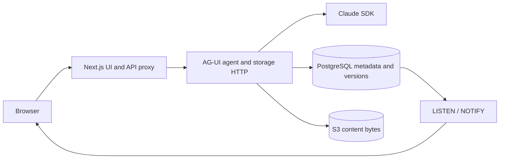

# Architecture

The browser renders a Next.js workspace. CopilotKit's runtime route connects to
an AG-UI agent on port 8000; `agent/src/server.ts` streams the Claude SDK adapter.
The agent also hosts storage HTTP routes and per-user file/node/experiment tools.
`src/lib/agent-proxy.ts` forwards storage requests and attaches a signed identity
when login is enabled. Browser state and authenticated storage access meet in
`src/components/workspace/store.tsx`; pane commands live in `workbench.tsx`.



The frontend and agent have separate manifests and lockfiles. `npm ci` at the
root installs both. The starter's charts, meeting picker and A2UI examples remain
under `src/app/declarative-generative-ui` and `src/hooks`; they are separate from
the knowledge workspace's persistence responsibilities.

### Skills

Skills are `SKILL.md` folders in the [Claude Code / Agent Skills](https://docs.claude.com/en/docs/agents-and-tools/agent-skills/overview)
layout. Claude gets the built-in ones (`agent/skills/`), skills installed from the
[skill hub](#skill-hub), and the workspace's own `skills/<name>/` at the root (with
[file storage](#file-storage)); a workspace skill hides a hub or built-in one of the same name.
In the **Skills** view each one is set to:

- **Auto:** Claude uses it when it fits, and `/name` runs it.
- **Manual:** only when you type `/name` in the chat.
- **Off:** not available.

A mode can be chosen at three levels, and the most specific one applies: **for everyone**
(set in the Skills view by editors and owners of the workspace root), **yours** (the Skills
view's Auto / Manual / Off, with "Use default" to go back), and **this chat** (the "This chat"
button under the input). Anyone who can read a skill can use it; adding or changing one
takes edit access to the workspace's `skills/` folder. When Claude writes a skill, it becomes a
proposed change that someone with edit access accepts, and Claude never turns skills on or off.

Typing `/` in the chat lists the skills you can run; the line under the
input says which skills are on and which ones the current turn used. By default skills are
instructions only: no shell, and `!` commands in a SKILL.md are not run. The agent server copies
each user's skills into its own working folder for runs (`SKILLS_RUN_DIR`, default a temp
folder), and only `/name` for one of those skills reaches the SDK as a command.

#### Skill scripts

A deployment can let skills run the scripts they ship (`scripts/`, `*.py`, `*.sh`, ...) with
`SKILL_SCRIPTS=on` (`agent/src/skills/run.ts`). A run whose skills include one with scripts then
gets the SDK's Bash tool, always inside the SDK's sandbox (bubblewrap on Linux, which the agent
host must have; the run fails rather than run a command unsandboxed):

- **No network**: commands can't reach the internet, other hosts or the agent's own ports.
- **Files**: writes only in the user's run folder, and not to its skills. The agent's own folder
  (code, `.env`), its home (including the SDK's chat history) and other users' run folders
  can't be read.
- **No secrets**: the run's environment keeps only basics such as `PATH`, `HOME`, the locale and
  the model, so no `DATABASE_URL`, `AUTH_SECRET`, S3 or proxy settings. The SDK itself needs an
  API key, and its commands would inherit it, so the run gets a stand-in key that only a proxy
  inside the agent accepts (`agent/src/skills/keyproxy.ts`, on 127.0.0.1); the proxy sends
  requests on to Anthropic with the real key.

Commands run without a permission prompt because they're sandboxed; `!` commands in a SKILL.md
stay off. The Skills view marks a skill with scripts with a terminal icon when they run, and a
warning when they don't. Python or other interpreters the scripts need must be installed on the
agent host.

### Skill hub

With file storage, a deployment has one skill hub (`011_skill_hub.sql`), opened with
**Browse hub** in the Skills view:

- **Publish** (owners of the workspace root) snapshots a workspace skill as the next numbered
  version. A version never changes: its files are stored as blobs by content hash, and
  publishing unchanged files adds no version. Whoever publishes a name first owns it on the hub.
- **Install** (editors) pins a version for the whole workspace. Hub skills start as **Manual**,
  so someone else's instructions reach Claude only when a user runs `/name`, until someone
  makes them Auto. A newer version shows as **Update to vN** on the skill's row.
- **Fork** (editors) copies the installed version into `skills/<name>/` to change it there,
  and removes the install it replaces.
- **Export** downloads any skill as a `.zip` in the Agent Skills layout (`<name>/SKILL.md`, ...),
  which Claude Code reads too; **Import .zip** (editors) adds one as `skills/<name>/`, asking
  before it replaces a folder that exists. A skill may have up to 200 files and 5 MB.

Trust (`012_hub_trust.sql`) helps people decide what to install:

- **Publish check**: each version is scanned as it's published (`agent/src/skills/scan.ts`) for
  scripts, links and network commands, large or binary files, hidden text (invisible characters,
  HTML comments, long encoded runs) and instructions such as "ignore previous instructions" or
  "don't tell the user". Flags show on the hub and before an update; they warn, they don't block,
  and a clean check doesn't mean a skill is safe.
- **Verified**: hub admins mark a version as checked. Admins are the users listed in
  `HUB_ADMINS` (emails or login subjects), plus the built-in user when there is no login. A new
  version starts unverified.
- **Reports**: anyone can report a skill; its publisher and the hub admins see open reports, and
  admins dismiss them. Each person has one open report per skill.
- **Yank**: a skill's publisher or an admin can yank a version. It can't be newly installed,
  and "latest" skips it; workspaces that have it keep it working, with a warning to update or
  remove it.
- **Update diffs**: **Update to vN** first shows the file-by-file diff and the new version's
  flags, and updates only when confirmed.

Claude has no tools for the hub: installing, publishing and forking are the user's own
actions. `GET /api/hub?q=` lists and searches, `GET /api/hub/<name>?version=` shows a version's
SKILL.md, `POST /api/hub {skill}` publishes, `PUT|DELETE /api/hub/<name>/install` installs
(`{version?}`) or removes, `POST /api/hub/<name>/fork` forks, and `GET /api/skills/<name>/export`
and `POST /api/skills/import?replace=1` move `.zip` files. For trust:
`GET /api/hub/<name>/diff?from=&to=`, `POST /api/hub/<name>/verify {version, verified}`,
`POST /api/hub/<name>/yank {version, yanked, reason?}`, `POST /api/hub/<name>/reports
{reason, version?}` and `DELETE /api/hub/<name>/reports?id=`.

### Runs: Focus and Traverse modes

A **run** (RUN_DIR) is a plain folder holding one experiment run's artifacts. Any folder that
contains a marker folder is a run, `xdoe-report/` by default (set `RUN_DIR_MARKERS`,
comma-separated, to add more). The workspace works in one of two modes:

- **Traverse** (`/`): the **Traverse** view on the icon rail lists every run. There is no chat.
- **Focus** (`/?run=runs/etch-2026-10-01`): the panes work on that run. The Files view is
  rooted at it (new notes and uploads land in it), the title bar shows where you are with a
  button to leave, and Claude gets the run as context (its path, files and
  `xdoe-report/report.md`). Picking a run opens its report.

The URL is the source of truth, so links open a run directly and back/forward move between
runs. A link to a run that isn't there falls back to Traverse with a notice.

### Actions

In Focus mode the Files view ends with a foldable **Actions** block (like VS Code's Outline
and Timeline sections), whose buttons act on the current run:

| Action | Role | Does |
| --- | --- | --- |
| **New Chat** | viewer | starts an empty conversation, still about the same run |
| **Generate Rules** → **Open Rules** | editor to generate, viewer to open | without `<run>/models/general_rules.md`: asks the rules API once, writes the file read-only and opens it; once it exists: opens it |

Actions are entries in one registry (`src/components/workspace/actions.tsx`), each with an
id, the role it needs, whether Claude may run it, a `view(ctx)` that gives its label, icon
and state for the current run, and a `run(ctx)` that acts only through the workbench
contract and the file API. One runner serves the block and Claude: it refuses disabled,
unauthorized or already-running actions, so a double click never runs one twice.

The role is the user's role where the run lives (the knowledge node, experiment or workspace
root), as the grants give it. A viewer there sees Generate Rules disabled, with a tooltip
saying why, and Claude acting for them gets the same refusal. The server checks again: any
write, a read-only file included, needs editor. Without server storage the single user owns
everything.

#### Rules API

Generate Rules gets JSON from `GET /api/rules?run=<run>`. The Next.js server forwards that to
`RULES_API_URL` (`GET <url>?run=<run>`), so the API's address stays off the browser. Without
`RULES_API_URL` it answers with a built-in mock (`src/lib/rules-mock.ts`), which is also served
at `/api/mock/rules`. The answer looks like this:

```json
{ "run": "runs/etch-2026-10-01", "generatedAt": "2026-10-08T00:00:00.000Z",
  "rules": [{ "id": "R1", "title": "…", "condition": "…", "action": "…", "confidence": 0.93 }] }
```

A fixed transform (`src/components/workspace/rules.ts`, unit tested) turns it into a markdown
table. The file is written once and is read-only for everyone, Claude included: the editor
only previews it, and the file API refuses to change or delete it.

The API is called at most once per run. The button is disabled while it works, and a lock
shared by the browser's tabs, plus a check with the server just before the call, stops a
second tab from asking again. The write only creates (`If-None-Match: *`), so even two
browsers can't overwrite the file. Without server storage, files live in each tab separately,
so only the first two guards apply.

### Workbench contract

Everything that moves panes goes through one typed API, `useWorkbench()`
(`src/components/workspace/workbench.tsx`): title bar buttons, the icon rail, the phone pane
switcher, file references in answers, and Claude's open-file tools.

| Part | Does |
| --- | --- |
| `mode`, `runDir`, `runs` | Focus or Traverse, the focused run, every run in the workspace |
| `run.focus(path) / leave()` | moves to a run (a new history entry) or back to Traverse |
| `panes.isOpen / show / hide / toggle(pane)` | `"explorer"`, `"editor"` or `"chat"`; on phones `show` switches to that pane |
| `panes.resize / resetSize(pane, width)` | splitter drags, clamped to each pane's range |
| `sidebar.select / show(view)` | the icon rail (`select` on the active view collapses the panel) |
| `editor.open(path, lines?)` | opens a file or the task board, optionally at cited lines |
| `chat.newThread() / focus()` | starts an empty conversation / puts the cursor in the chat (Focus mode only) |
| `notify(message, level)` | a short notice in the corner |

Claude drives the same contract through frontend tools: `showPane` / `hidePane`,
`listRuns` / `focusRun`, `openWorkspaceFile`, and `listActions` / `runAction`. `runAction`
goes through the Actions block's runner with the user's role, and only runs actions marked
`agentInvocable` (Generate Rules is; New Chat isn't, since it would end Claude's own
conversation). Claude can't leave the run, because Traverse mode has no chat.

The layout itself is plain data changed by a reducer (`layout.ts`), so its rules are unit
tested (`tests/unit/workbench.spec.ts`), and a test fails if anything outside the workbench starts
keeping its own pane state.

### File references in answers

Claude's answers can point at a file, or at lines in it, and a click opens them in the middle
pane. A reference is a plain Markdown link to the workspace path, with a GitHub-style line
fragment (the format Claude Code uses in IDEs):

| Claude writes | A click opens |
| --- | --- |
| `[welcome.md](notes/welcome.md)` | the file |
| `[welcome.md:12](notes/welcome.md#L12)` | the file at line 12 |
| `[welcome.md:12-18](notes/welcome.md#L12-L18)` | the file at lines 12–18 |

Paths are relative to the workspace root; lines are 1-based and inclusive. The preview
highlights the paragraphs, list items, table rows or code blocks the lines belong to, and the
editor selects the lines themselves. Links to files that aren't in the workspace show greyed
out, and web links work as before.

Claude learns the format from the system prompt (`agent/src/agent.ts`), and file content
reaches it with numbered lines (the open file in context, and `readWorkspaceFile`), so it can
cite them. The contract lives in `src/components/workspace/file-refs.ts`, whose parser also
accepts `#L12-18` and `notes/welcome.md:12`.


## File storage

Workspace files can live in Postgres + an S3-compatible object store instead of
the browser (see issue #4). It is optional; without
`DATABASE_URL` the app runs as before.

For local setup, see [Development](development.md).

- **Postgres** (15 or newer) holds the file tree, every version of every file, and who
  wrote it (`agent/src/storage/migrations`). Migrations run when the agent starts.
- **Object store** holds the bytes, keyed by their sha256, so identical content is
  stored once and old versions stay readable. Any S3-compatible store works:
  SeaweedFS or Garage self-hosted, or AWS S3, Cloudflare R2, Backblaze B2.
- **API**: the agent server serves `/files` and Next.js forwards `/api/files/*` to it.
  `GET /api/files` lists files, `GET|PUT|DELETE /api/files/<path>` reads, writes
  (request body = bytes) and deletes one, `?versions` returns its history, and
  `GET /api/files?watch` streams every change as server-sent events (Postgres
  LISTEN/NOTIFY, so it works across processes). A `PUT` with `If-None-Match: *` only creates
  (412 if the file exists), and `X-Read-Only: true` makes a new file read-only: after that,
  `PUT` and `DELETE` answer 403, for every role. Login is optional (see below); keep the agent port private in either mode.
- **Knowledge tree**: files live at the workspace root or in a node of a tree whose levels
  are data (`node_types`, seeded as tech › module › loop › process). Nodes are stored with
  Postgres `ltree`, and the database checks that each node sits exactly one level below its
  parent. Each node has its own files. `GET|POST /api/nodes` lists and adds nodes,
  `GET|PATCH|DELETE /api/nodes/<id>` reads (with its ancestors), renames and deletes one
  (with everything below it), and every `/api/files` route takes `?node=<id>`.
- **Experiments**: anyone who can view a node (usually a process) can fork it into an
  experiment. The experiment gets its own copy of the node's file list, pointing at the same
  stored bytes, and from then on every change, by the user or by Claude, stays in the
  experiment. It records a hypothesis, parameters and results as JSON, so the experiments on
  one node compare side by side. A draft is seen only by its author; shared and archived ones
  by everyone who can view the node; only the author changes it, and an archived one is read
  only until restored. `GET|POST /api/experiments` lists (optionally `?node=<id>`) and
  forks, `GET|PATCH|DELETE /api/experiments/<id>` reads, changes and deletes one, and every
  `/api/files` route takes `?experiment=<id>`. In the Knowledge view, experiments sit under
  their node with their status, and the Experiment tab holds the details and a comparison
  table. Its author brings its results to the node by proposing them (below).
- **Proposed changes**: a change to a node's file can wait for review instead of landing at
  once (`008_proposals.sql`). Claude's edits in a node arrive this way, as do the skills
  Claude writes at the workspace root (`skills/<name>/`), and so does an
  experiment's work when its author proposes it from the Experiment tab (only files the
  experiment changed, so a proposal never undoes someone else's later work on the node).
  Anyone who can view a node may propose; editors there accept or reject in the Proposed
  changes tab, which shows each one as a diff against the file as it is now, and accepting
  writes it as the file's next version, credited to whoever proposed it. Proposing again
  revises your open proposal. `GET /api/proposals` lists open ones (`?node=`,
  `?experiment=`, `?status=`), `PUT /api/files/<path>?node=<id>&propose` proposes, `POST
  /api/proposals {experimentId, paths?, note?}` promotes an experiment, and `POST
  /api/proposals/<id>/accept|reject|withdraw` decides.
- **Search**: every text file is indexed when it is written (`006_search.sql`): its text is
  split into passages and stored once per distinct content, so versions, experiment copies and
  duplicates share one entry. `GET /api/search?q=<text>` finds the files you can read whose
  words (with their forms, so etch finds etching) or exact text (part numbers, CJK) or path
  match, with the passage that matched. `&scope=<node id>` keeps to one node and everything
  below it, and `&near=<node id>` or `&experiment=<id>` ranks files near there first. Files
  stored before search existed are indexed in the background when the agent starts. The
  Search view in the left rail searches as you type and opens a result where it lives.
- **Search by meaning**: with pgvector in Postgres (the `docker compose` image has it), a
  small multilingual embedding model (`Xenova/multilingual-e5-small`, MIT) runs inside the
  agent, so nothing leaves your server. It downloads once (about 120 MB, to
  `~/.cache/knowledge-chatroom/models` or `EMBEDDING_CACHE_DIR`), then embeds every passage
  in the background, and search also finds passages close in meaning ("chamber wall
  buildup" finds "polymer deposition on the liner"), marked "Similar meaning". Word
  matches still rank first; "quotes" or -word ask for exact words only. Without pgvector,
  or with `EMBEDDING_MODEL=off`, search matches words. Changing `EMBEDDING_MODEL` re-embeds
  everything.
- **Access**: users belong to groups in an org tree (company › dept › team), and a grant
  gives a user or group a role on a node and everything below it, or on the whole
  workspace. Roles are additive: viewer reads; editor also writes and deletes files (a deleted
  file keeps its history) and adds and renames nodes; owner also deletes nodes and manages
  grants. A grant to a group covers members of its sub-groups too.
  The API (`/api/access`: users, groups and members, grants, audit log) and Claude's tools
  check access in one place (`agent/src/storage/session.ts`), and every change is written to
  `audit_log` with who made it and whether Claude made it for them. Without login there is
  one built-in user who owns everything, so nothing changes for a single-user setup.
- **Login** (optional): set `AUTH_SECRET` (the same value for the app and the agent, at least
  32 characters, e.g. `openssl rand -hex 32`) and an OpenID Connect provider (`OIDC_ISSUER`,
  `OIDC_CLIENT_ID`, `OIDC_CLIENT_SECRET` if the client has one; Keycloak, Authentik, Google,
  Entra ID and others work). Register `<APP_URL>/api/auth/callback` as the redirect URI, and
  set `APP_URL` when the app sits behind a proxy. Users then sign in before the workspace
  opens; the app keeps them in a signed cookie and signs each request it forwards to the agent
  (`X-Knowledge-User`, valid for five minutes), so the agent port must stay private. The first
  person to sign in owns the workspace and shares nodes from the title bar's Share button
  (people show up there once they have signed in). Viewers get the files read only, and
  Claude's tools in a chat act as the person chatting.
- **Database-enforced access**: file and node queries made for a user run in Postgres as
  the restricted role `knowledge_user`, with row-level security policies
  (`agent/src/storage/migrations/004_row_security.sql`, `005_experiments.sql` for
  experiments and `006_search.sql` for indexed text) that apply the same grants. If a
  check in the app were ever missed, Postgres would still refuse. The migration creates the
  role when the database user may (`CREATEROLE` or superuser, as with `docker compose`);
  otherwise the agent logs that row-level security is off, and an admin can enable it with
  `CREATE ROLE knowledge_user NOLOGIN; GRANT knowledge_user TO <app user>;` before the next
  start.
- **Download links**: set `S3_PUBLIC_URL` to the object store's address as browsers reach it
  (e.g. `http://localhost:8333` with `docker compose`, or `https://s3.<region>.amazonaws.com`)
  and images and other binary files download straight from the store. After the access
  check, the API answers with a redirect to a signed link that works for five minutes.
  Text files are still served by the app, which the editor reads them through.
- **Claude** gets `list_nodes`, `create_node`, `list_files`, `read_file`, `search_files`,
  `write_file`, `list_experiments`, `create_experiment`, `update_experiment` and
  `propose_experiment` tools on the agent server
  (`agent/src/storage/tools.ts`), so it works with files even when no browser tab is open.
  The file tools take a `node` or an `experiment`; the chat context says where the user is,
  and inside an experiment Claude writes only there. Its writes are versions authored by the
  agent; in a knowledge node they are proposed changes until someone accepts them.
- **UI**: on load the workspace checks `/api/files`. If it answers, files load from the
  server, edits save there (debounced), and the change stream brings in Claude's writes and
  edits from other tabs. Without login, the first visit to an empty server uploads this
  browser's files.
  The Knowledge view in the left rail shows the tree; clicking a node moves the workspace
  there (the title bar shows where you are), and each node keeps its own open tabs.
  If it doesn't answer, everything stays in localStorage and the browser-side file tools
  are used instead.
- **Tests**: `npm run test:integration` requires `TEST_DATABASE_URL` and `S3_ENDPOINT`;
  it resets a disposable test database. See [Testing](testing.md).


## Boundaries when changing code

Preserve `useWorkspace()` and `useWorkbench()` consumers while extracting internal
logic. Place identifiers distinguish root, node and experiment (`x:<id>`); never
key a pending save only by file path. Navigation must flush the place being left,
and late network responses must not overwrite another place's files. Local edits
and in-flight writes take priority over incoming SSE updates.

Experiments are persisted forks of a node's file list. Workbench runs describe UI/workflow traversal in Focus/Traverse modes; they do not
replace experiment storage.
Coordinate changes with the feature PR stack before introducing new semantics.
